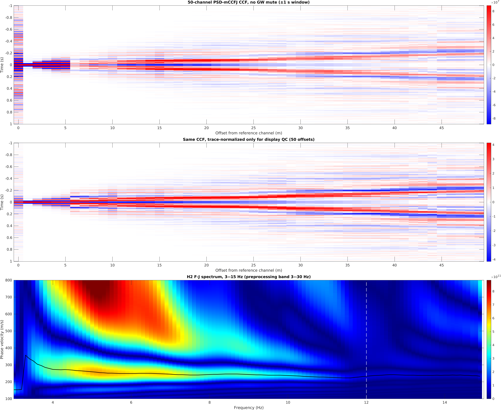

# DAS Init

从 San Jose DAS 项目的正式 MATLAB 主控整理出的独立部署包。参考流程为
`NyHtQInv/mainline6p0/MCCFJFLOW2Manual.m`，保留 MATLAB 科学计算与 Python DASQt 预处理。

```text
DASQt 全道预处理 → EDWav 筛选 → 600 s PSD互相关 → 按有效窗数叠加
→ 距离分箱 / 速度滤波 → H2 F-J（默认不做 GW mute）
→ 综合谱人工 polygon → 各日自适应 mask → F-J反变换 → 衰减提取
```

部署或重写前先读[数据与计算约定](docs/CONTRACT.md)：逐步说明物理含义、输入输出维度、
正负支折叠、FFT 缩放与数值验收。[demo 接口清单](docs/demo/contract.json)可供程序读取。

## 环境

- Linux；推荐 MATLAB R2023a 或更新版本，Signal Processing Toolbox、Parallel Computing Toolbox。
- Python 3.12。预处理依赖固定为 NumPy 1.26.4、SciPy 1.13.1、h5py 3.12.1。
- 默认 CPU 计算；并行进程数由配置控制。DASQt 只带所需后端源码，不需要 Qt GUI 或 PyTorch。
- MATLAB 及工具箱由目标机器提供，仓库不包含它们。

## 部署

```bash
git clone https://github.com/zhangchang271/das-init.git
cd das-init
bash scripts/setup.sh
cp configs/san_jose.example.json configs/site.local.json
```

编辑 `configs/site.local.json` 的 `raw_dir`、`out_dir`、通道和计算参数。
相对路径以 **JSON 所在目录** 为基准。默认 Python 为项目内 `.venv/bin/python`；也可在 JSON
中设置 `dasqt_python` 的绝对路径，或通过环境变量 `DAS_WORKFLOW_PYTHON` 指定已有 Python。
`DAS_SETUP_PYTHON` 可指定创建环境的 Python 3.12 解释器。

当前读取器适配 **San Jose BlossomHill HDF5**：

- 文件名 `BlossomHill_YYYYMMDD_HH-YYYYMMDD_HH_chXXXXX-XXXXX.h5`；
- 数据集 `Acquisition/Raw[0]/RawData`，排列为「时间 × 通道」；
- 根属性 `sampling_rate_Hz`、`start_time`、`end_time`、`channel_start`、`channel_end`。

其他仪器格式需先适配 `python/prepare_dasqt.py` 的读取和时间元数据；当前不声称支持任意 DAS 格式。
`raw_channel_first0` 是文件内从零开始的列索引，`reference_channel` 是选中阵列内从一开始的道号。
完整 HDF5 阵列先参与共模去除，再截取目标道段。

## 运行

```bash
# 首先检查 Python 和冻结的第三方代码，不读取原始数据。
.venv/bin/python scripts/check_python.py

# 可分步运行；preview 是默认配置，会停在综合 F-J 频散谱并生成 CCF/F-J 三联图。
bash scripts/run.sh configs/site.local.json edwav
bash scripts/run.sh configs/site.local.json ccf
bash scripts/run.sh configs/site.local.json preview
```

仓库包含已确认的真实 San Jose demo [预览图和数值结果](docs/demo/README.md)，克隆后即可查看：



demo 附带一份 600 秒、50 道的 DASQt 预处理缓存，可直接重跑 EDWav、PSD-CCF 和 F-J：

```bash
bash scripts/run.sh configs/demo_small.json preview
```

缓存中的 50 道波形来自完整 500 道阵列的 DASQt 共模预处理，保持了本仓库展示结果的输入。
原始 500 道 HDF5 不随仓库分发；如需从原始数据重新执行预处理，可用
`scripts/extract_demo_segment.py` 提取 600 秒片段。重跑输出写入 `outputs/demo_sanjose_small/`。
`scripts/make_demo_data.py` 只用于合成数据安装测试。

若 MATLAB 不在 PATH 中，可设置 `MATLAB_BIN=/实际路径/bin/matlab`。
在交互 MATLAB 中，从项目根目录运行以下命令，首次画 mask 并继续衰减提取：

```matlab
run_workflow('configs/site.local.json','pick');
```

以后复用该输出目录内的 `manual_mask_polygon.mat`：

```bash
bash scripts/run.sh configs/site.local.json attenuation
```

重新执行会复用匹配的预处理、EDWav 筛选与 CCF 缓存。
预处理参数、源文件大小或修改时间变化会使相关片段缓存失效。
CCF 设置、EDWav 道段选择或预处理片段变化会使对应日期的 CCF 失效。
只改 mute、F-J 或 mask 时可复用 CCF。每次运行保存完整配置、MATLAB 环境及算法源码指纹。
同一个输出目录应由一个任务写入；不同数据或并发任务使用不同 `out_dir`。

## 参数

默认示例为原来的 500 道、1 m 道间距、10 m gauge length、200 Hz、144×600 s。
第 1 道到全部 500 道构成参考道记录；默认没有计算 500×500 全道对。
`NF='PSD'`、`NT='No'`、`TP='No'`、H2 / No-window F-J、J0 衰减沿用参考流程。
带通、共模去除、EDWav、mute 和振幅处理见 [处理说明](docs/PROCESSING.md)。

当前 San Jose 原始项目已运行到综合 F-J；人工 mask 与最终衰减尚未完成。
部署包包含后续代码，不能据此视为最终衰减已验证。其他地区需重新选择有效频段、速度滤波、mute 和人工 mask。
默认 CCF 预览和 MAT 结果只保留 ±1 s 时间窗口；F-J 使用正负两支对应平均后的完整半支重建频谱，未按 ±1 s 截断。`preview` 生成参考图样式的三联图：窗口内原始 CCF、仅用于显示的逐道 RMS 归一化 CCF，以及综合频散谱。1–3 Hz 低于 DASQt 预处理带通下限，只作显示参考，建议重点检查 3–12 Hz。
默认 ridge 使用主流程的 `findpeaks` 趋势追踪。
处理约定及其与 `passive-cross-correlation` skill 的对应关系见 [skill 回顾](docs/SKILL.md)。

## 验证

真实 demo 重跑后，在 MATLAB 中执行 `addpath('scripts'); report = validate_demo;`。
它对比筛选、中间 CCF、最终窗口及频散谱幅值；其他程序可导出同字段 MAT 进行比较。
详见[验收接口](docs/CONTRACT.md#9-最终文件接口与验收)。

```bash
.venv/bin/python -m unittest discover -s tests -p 'test_*.py' -v
```

Python 测试只生成小型合成数据，检查独立导入、共模处理孔径、缓存失效、断点复用和批处理入口。
在具备许可的 MATLAB 中运行：

```matlab
results = runtests('tests/test_matlab.m');
assert(all([results.Passed]));
```

MATLAB 测试检查配置、PSD 公式、有效窗数、整体幅度缩放不变性及路径参数传递；它们不能代替真实数据的频散和衰减 QC。
本次实际检查及 MATLAB 退出码的限制见 [验证记录](docs/VALIDATION.md)。

## 来源

原始 HDF5、计算缓存、批量结果、日志、本机配置和环境均由 `.gitignore` 排除。
程序、配置示例、测试、文档、已确认的 `docs/demo/` 示例结果及所需源码快照进入版本控制。
第三方来源与授权状态见 [THIRD_PARTY.md](THIRD_PARTY.md)；源码指纹见
[vendor/manifest.json](vendor/manifest.json)。本项目没有统一开源许可证；
公开可见不代表第三方代码已获统一授权，使用和再分发须遵守各自的授权条件。
