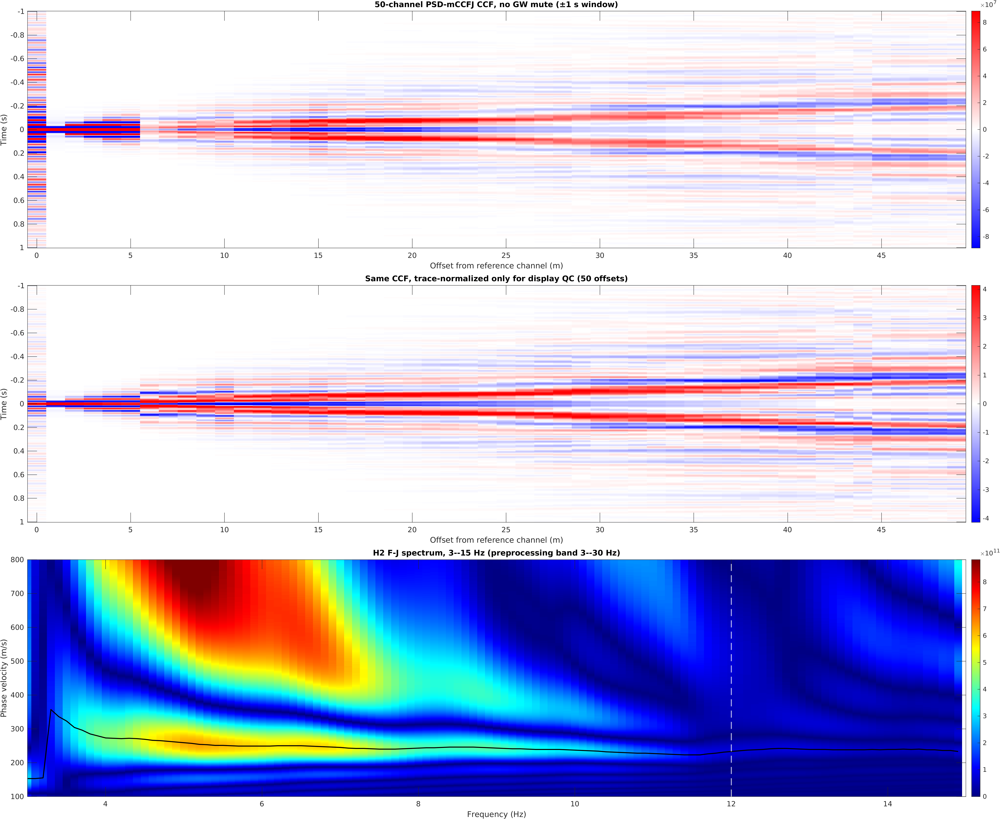

# San Jose demo

这里保存已确认的真实数据 demo 结果和可重跑的输入缓存。`preview.png` 来自主流程输出，
`result.mat` 从同一次运行的 MAT 输出中提取，未重新计算或调整频散谱。



| 项目 | 设置或结果 |
| --- | --- |
| 数据 | San Jose，2023-09-20 00:00–00:10，沿用源文件时间 |
| 采样率 | 200 Hz |
| 预处理阵列 | 原始 ch16700–17199，共 500 道 |
| 分析阵列 | ch16700–16749，共 50 道；道间距 1 m，偏移 0–49 m |
| 输入相关窗 | 一个完整 600 s 片段 |
| EDWav | 50/50 道片段通过；每个参考道对有效窗数为 1 |
| CCF 输出 | 401×50，保留 −1 至 +1 s 窗口 |
| F-J | 完整频域 CCF 输入；H2、No-window、无 GW mute |
| 频散谱 | 701×120；100–800 m/s，3.0–14.9 Hz |
| ridge | 主流程 `findpeaks` 趋势追踪 |

CCF 两侧是主流程正负时间对称平均后的结果；第二幅图的逐道 RMS 归一化只用于显示。
F-J 幅值为 `abs(real(FJ.dsp))`，没有逐频率归一化。50 道短阵列、单个片段的 demo
用于检查部署和流程，不代表全天 500 道结果的分辨率或稳定性。

## 可重跑输入

仓库在 [`data/demo_sanjose_50ch/segments/`](../../data/demo_sanjose_50ch/segments/) 中附带一个
约 22 MB 的 MATLAB 缓存，包含 50 道 × 600 秒、已按完整 500 道阵列完成 DASQt 预处理的波形。
它不是原始 HDF5；原始的 500 道 10 分钟片段约 107 MB，没有打包。缓存保留全阵列共模去除后的
50 道输入，因此可以从 EDWav 开始重新运行并重现当前 CCF/F-J 结果。

在项目根目录执行：

```bash
bash scripts/run.sh configs/demo_small.json preview
```

CCF cache 和图表会在 `outputs/demo_sanjose_small/` 中重新生成。

## 数值结果

[下载 result.mat](result.mat)，在 MATLAB 中读取：

```matlab
S = load('docs/demo/result.mat');
size(S.ccf_gather)              % 401 x 50
S.ccf_time_s([1 end])           % -1; 1
size(S.spectrum)                % 701 x 120
imagesc(S.frequency,S.velocity,S.spectrum); axis xy;
```

文件包含 CCF、时间轴、偏移、F-J 幅值谱、频率和速度轴、ridge、有效窗数、EDWav
选择、原始有效道标记、日期及处理参数。本机目录和缓存路径未打包。
它是频散预览结果，不包含原始 HDF5、完整 CCF cache、复数 F-J、人工 mask 或衰减结果。

## 从原始 HDF5 重建缓存

如需重新执行 DASQt 全阵列预处理，先从原始数据提取 600 秒，再按[主 README](../../README.md)
配置原始输入流程。重新完成 `preview` 后，在项目根目录的 MATLAB 中运行：

```matlab
addpath('scripts');
export_demo;
```

该命令将当前 `outputs/demo_sanjose_small/` 的预览图和精简结果更新到本目录。
